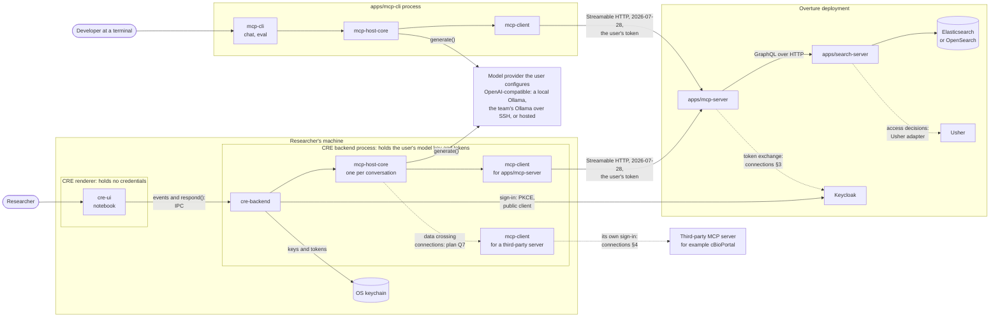
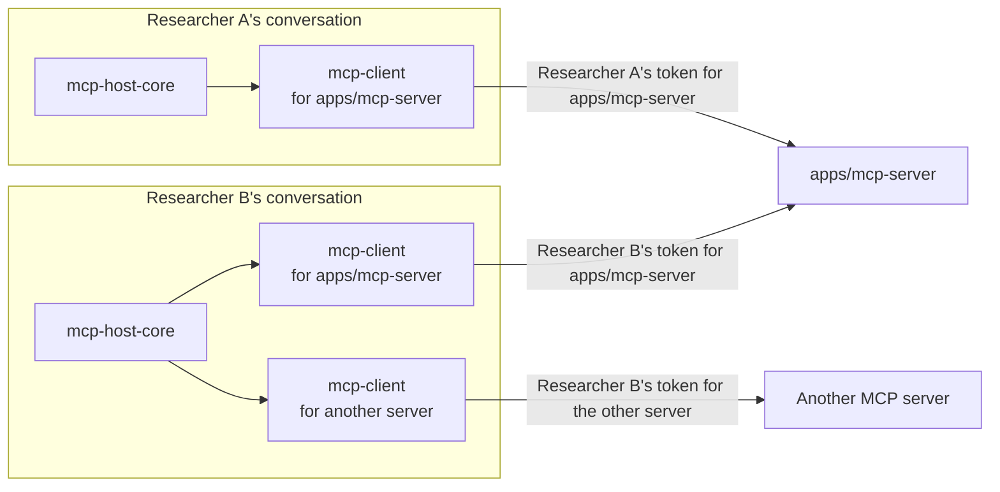
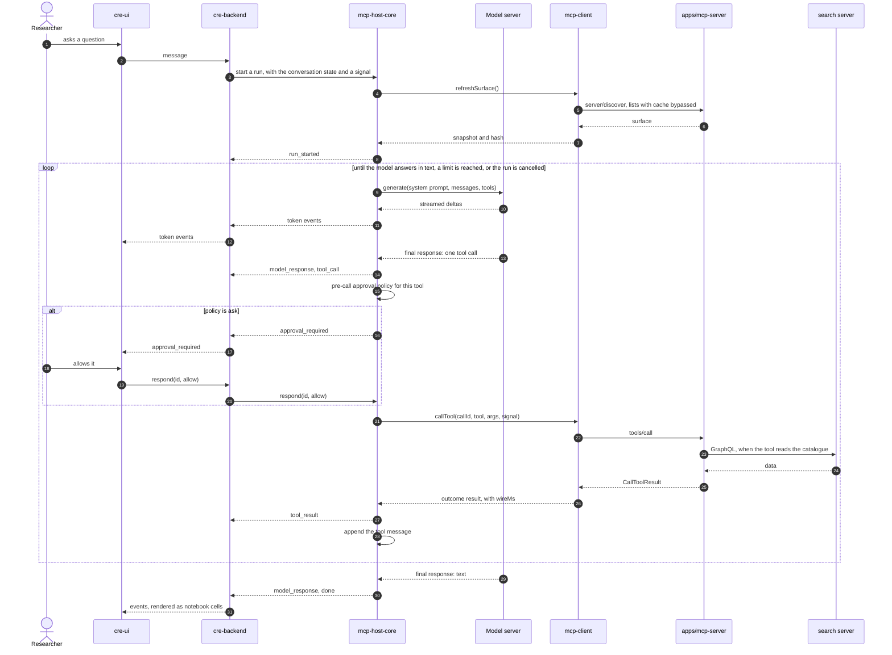
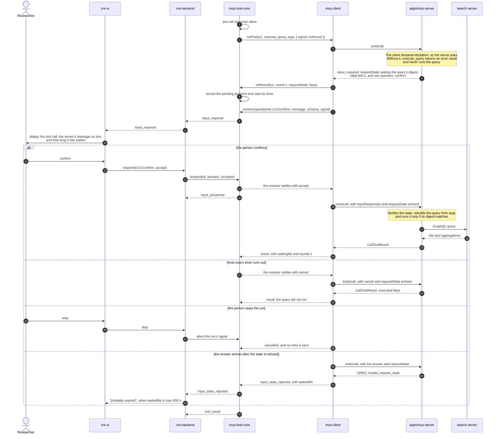
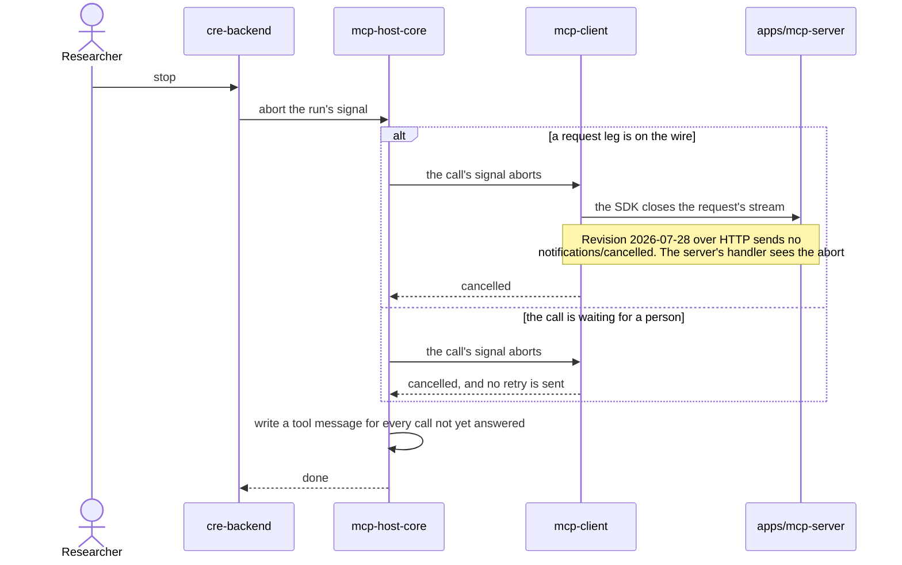

# MCP Host: Architecture

How the pieces of the [MCP Host Plan](mcp-host-plan.md) fit together at run time, from the CRE notebook down to the search server. The plan records each decision and the reason for it. This document draws them.

**Reading the diagrams:** a solid line is decided. A dashed line is open or not built yet, and its label names the question that settles it.

The client's internals are drawn in [mcp-client: Architecture](../../../modules/mcp-client/docs/architecture.md).

## System context

The end state for the CRE desktop app, with the terminal CLI beside it.

The rules behind the boundaries:

- **Credentials never reach the renderer** ([plan §1](mcp-host-plan.md#1-overview), rule 3). The renderer displays untrusted text, so script injected there must find no keys and only a narrow IPC API ([plan §2.5](mcp-host-plan.md#25-cre-ui)).
- **The model key and tokens are the user's own**, kept in the OS keychain. Nothing secret ships in the app ([plan §2.2](mcp-host-plan.md#llm-provider-interface)).
- **Each `mcp-client`** holds one user's credential for one server. An Overture token never reaches a third party, and a third party's token never reaches Overture ([connections](../arranger-auth/mcp-host-connections.md) §4).
- **Text from a server is untrusted** unless the app's shipped configuration marks that server `trusted`. A server the user adds starts untrusted. Instructions, confirmation messages and tool results stay labelled as server output, and the UI renders them as text, never HTML ([plan §1](mcp-host-plan.md#1-overview), rule 5).

The open lines, and what settles each:

| Open item                   | Open because                                                                                 | Settled in                                                                                                          |
| --------------------------- | -------------------------------------------------------------------------------------------- | ------------------------------------------------------------------------------------------------------------------- |
| cre-backend's process       | Electron's main process, or a Node sidecar under Tauri.                                      | [Plan §5](mcp-host-plan.md#5-open-questions) question 9                                                             |
| host-core to a third party  | After controlled data enters the model's context, a call to another server can carry it out. | [Plan §5](mcp-host-plan.md#5-open-questions) question 7, [connections](../arranger-auth/mcp-host-connections.md) §6 |
| mcp-client to a third party | Consent, storage, refresh and revocation of per-person tokens are not designed.              | [Connections](../arranger-auth/mcp-host-connections.md) §4                                                          |
| apps/mcp-server to Keycloak | Today `apps/mcp-server` calls the search server with no credential.                          | [Connections](../arranger-auth/mcp-host-connections.md) §3                                                          |
| search server to Usher      | The Usher adapter is planned, not built.                                                     | [Arranger auth](../arranger-auth/index.md)                                                                          |
| `eval` inside apps/mcp-cli  | `eval` may instead be built as `apps/mcp-eval` in this repository.                           | [Plan §5](mcp-host-plan.md#5-open-questions) question 4                                                             |

## Instances and concurrency

Each conversation gets its own host-core instance, which holds one client per configured server. Two researchers using the same server never share a client, so neither shares a credential.

What runs at the same time, and why:

| Per          | There is                                                                               | Because                                                                                                                       |
| ------------ | -------------------------------------------------------------------------------------- | ----------------------------------------------------------------------------------------------------------------------------- |
| Conversation | One host-core instance, and one mcp-client per server                                  | A client holds one user's credential for one server, and is never reused ([plan §2.1](mcp-host-plan.md#21-mcp-client))        |
| Conversation | At most one active run. Starting another, for example from a second window, is refused | The next two limits depend on it, and so does who may answer ([plan §2.2](mcp-host-plan.md#agent-loop))                       |
| Run          | One tool call at a time                                                                | Transcript order is execution order ([plan §2.2](mcp-host-plan.md#agent-loop))                                                |
| mcp-client   | At most one call in flight                                                             | A question from the server belongs to that call, so it needs no routing ([plan §2.1](mcp-host-plan.md#the-confirmation-loop)) |
| Call         | Up to `maxRounds` confirmation rounds, 10 by default                                   | A server that keeps asking is stopped with `rounds_exceeded`                                                                  |
| Round        | Any number of questions, asked together                                                | The first to fail withdraws the rest                                                                                          |

A saved notebook is one conversation: its state plus its events ([plan §2.2](mcp-host-plan.md#conversation-state)).

## A question with no confirmation

A researcher asks a question, and the model answers after one tool call. The server asks nothing. Most of the events host-core emits are left out, to keep the flow readable. The full list is in [plan §2.2](mcp-host-plan.md#events).

- **One tool message per tool call**, whatever the outcome, or the conversation cannot continue. Its fixed wording for each outcome is in [plan §2.2](mcp-host-plan.md#agent-loop).
- **The model never sees an approval or a confirmation**, only the tool message that follows it.
- **Before each turn,** host-core estimates the prompt against the context window and shortens old tool results if needed. The diagram leaves this out ([plan §2.2](mcp-host-plan.md#context-window)).

## A question with a server confirmation

`execute_query` asks the person to confirm the query before it runs. Two different approvals are involved, and they are easy to confuse:

| Step                | Raised by                       | Answered by                                        |
| ------------------- | ------------------------------- | -------------------------------------------------- |
| Pre-call approval   | Host-core, before calling       | Host-core's policy: allow, deny, or ask            |
| Server confirmation | The MCP server, inside the call | The person only. Host-core never answers it itself |

The diagram starts after the model has asked for `execute_query`.

- **`onRound` runs before the question is asked**, so host-core already holds the `requestState` while it waits. That is why the client drives the rounds itself rather than letting the SDK do it ([plan §2.1](mcp-host-plan.md#the-confirmation-loop)).
- **A UI that reconnects mid-question** calls `pending()` to redraw the dialog. `respond()` is idempotent, and returns `accepted`, `unknown`, `already_answered` or `timed_out`.
- **Closing the app does not resume the question.** The call gets the "abandoned" tool message when the conversation is restored ([plan §5](mcp-host-plan.md#5-open-questions), question 2).

## Cancellation and timeouts

Each clock has exactly one owner. A second clock on the same wait, in `mcp-client`, could fire first and leave a question listed as pending whose answer goes nowhere.

| Clock                   | Owner           | What it times                              | When it runs out                          |
| ----------------------- | --------------- | ------------------------------------------ | ----------------------------------------- |
| Request leg timeout     | The SDK         | One request leg. Default 60 s              | `transport_error`, kind `timeout`         |
| Confirmation timeout    | mcp-host-core   | Waiting for a person to answer the server  | The answer `cancel` is sent to the server |
| Approval timeout        | mcp-host-core   | Waiting for a pre-call approval            | The call counts as denied                 |
| Run limits              | mcp-host-core   | Turns, tool calls and wall-clock time      | The run ends, and `done` names the limit  |
| `requestState` lifetime | apps/mcp-server | Between the question and the answer: 600 s | `input_state_rejected`                    |

Cancelling is one `AbortSignal` per run, passed down to each call:

`mcp-client` reports `cancelled` from the caller's own signal, not from the SDK's error. Phase 0's S2b found that the SDK raises the same `REQUEST_TIMEOUT` for an abort and a timeout ([results](phase0-results.md#s2b-cancellation-added)).
