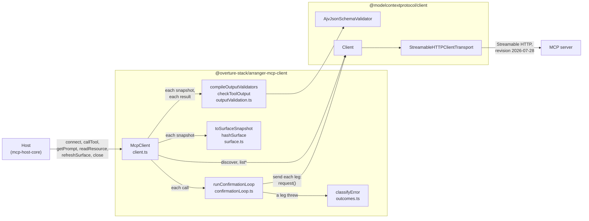
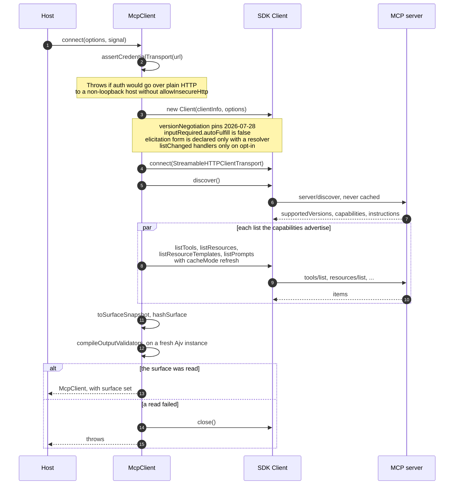
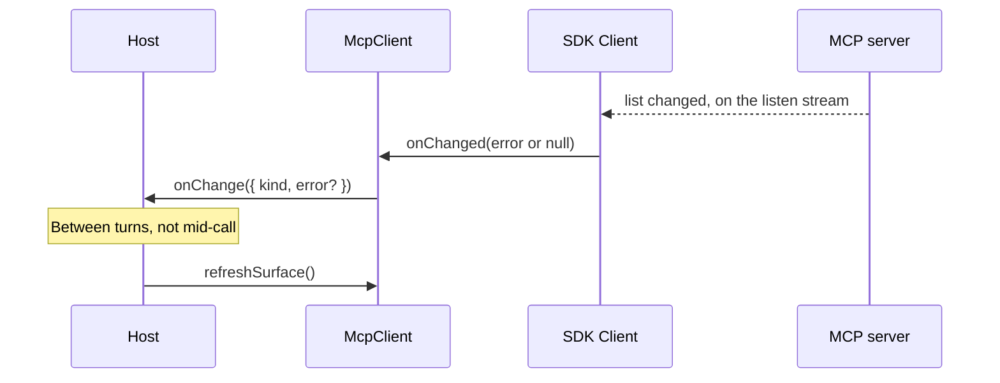
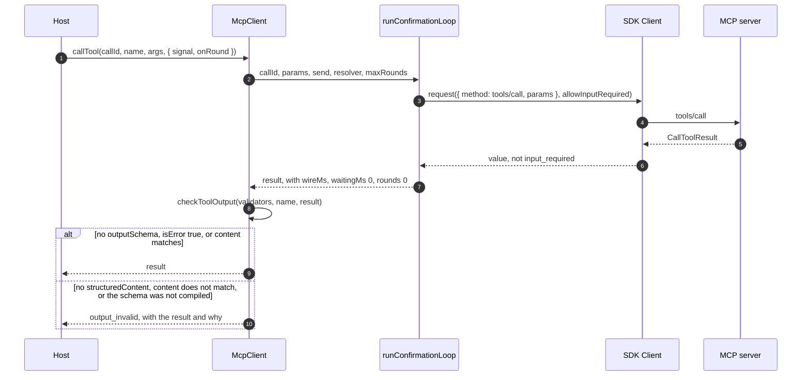
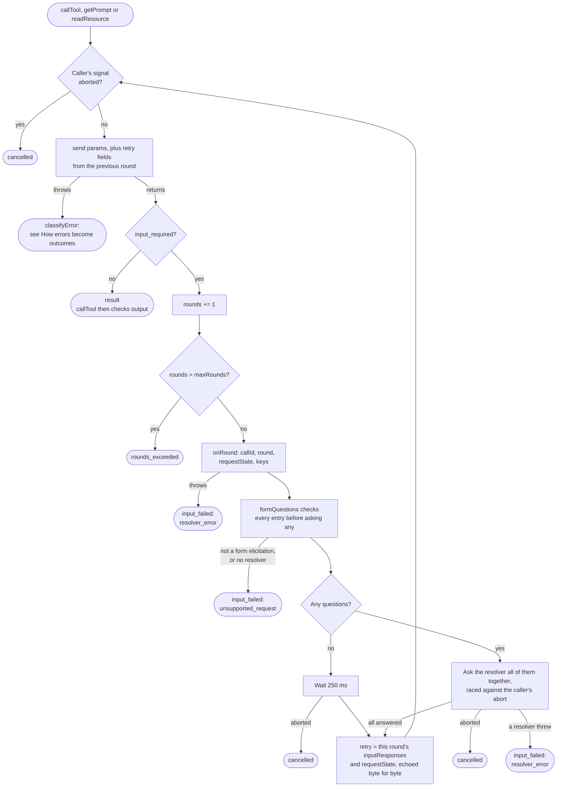
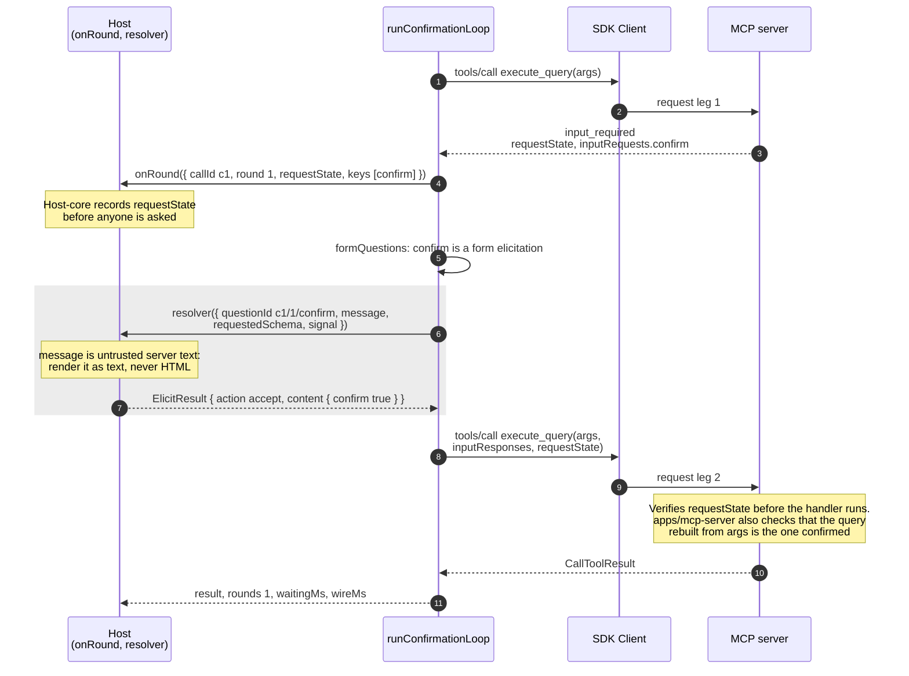
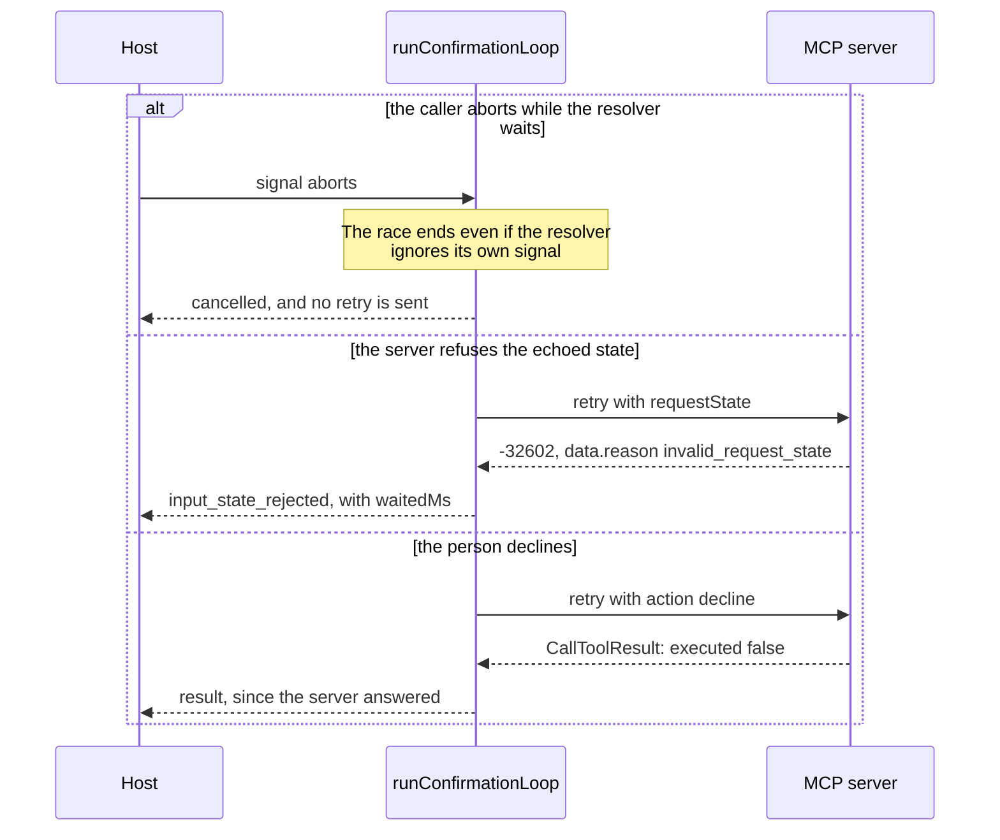
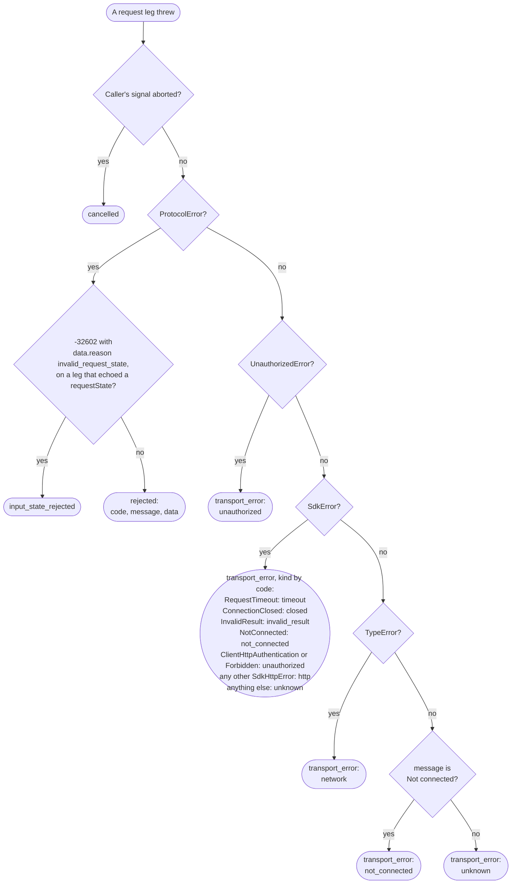
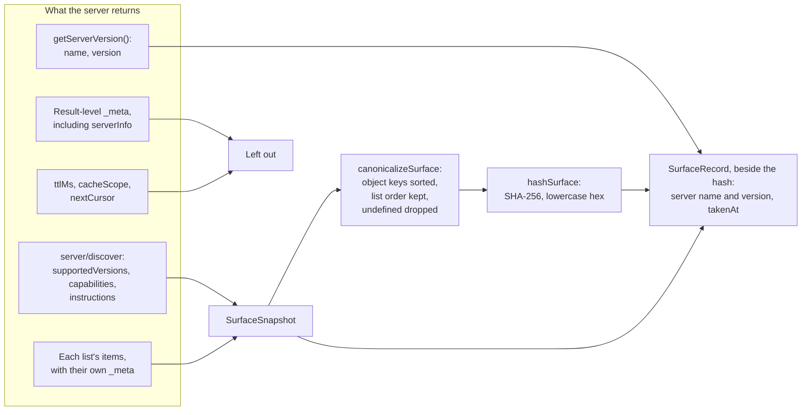

# mcp-client: Architecture

How `@overture-stack/arranger-mcp-client` works inside, drawn from its source. The [README](../README.md) covers usage, options and the outcome table. The [MCP Host Plan](../../../.dev/docs/mcp-host/mcp-host-plan.md) §2.1 records why each choice was made. For where this module sits among the other pieces, see [MCP Host: Architecture](../../../.dev/docs/mcp-host/architecture.md).

Each section names the functions it draws and the test files that cover them.

## Module map

A host creates one `McpClient` per server. `McpClient` owns the SDK's `Client` and hands each call to `runConfirmationLoop`, which turns everything that can happen into a `CallOutcome`.

| File                  | Owns                                                                                                                                  |
| --------------------- | ------------------------------------------------------------------------------------------------------------------------------------- |
| `client.ts`           | `McpClient`: SDK client options, the credential check, reading the surface, and the four request methods.                             |
| `confirmationLoop.ts` | `runConfirmationLoop`: sending each leg, `input_required` rounds, questions to the resolver, timing. Knows nothing of the SDK client. |
| `outcomes.ts`         | The `CallOutcome` types, and `classifyError`, which maps whatever a leg threw to one outcome.                                         |
| `outputValidation.ts` | Compiling each snapshot's `outputSchema`s on a fresh Ajv instance, and checking a tool's final result against them.                   |
| `surface.ts`          | Building the snapshot from named fields, canonical JSON, and the SHA-256 hash.                                                        |
| `types.ts`            | `InputResolver`, `InputQuestion`, `RoundInfo`, `CallOptions`, and the SDK types re-exported for hosts.                                |

**Not in this module:** models, tool-name namespacing, approvals, event formatting, retries, the timer on waiting for a person, and anything specific to Arranger. Those belong to the host.

`runConfirmationLoop` takes a `send` function rather than the SDK client, so `confirmationLoop.test.ts` drives it with scripted replies, including requests a compliant server never sends.

## Connecting and reading the surface

`McpClient.connect` checks the credential's transport before sending anything. It then reads the server's surface with every cache bypassed.

`refreshSurface()` runs the same read, from `discover()` onward, and replaces both the snapshot and the compiled validators. Host-core calls it at the start of each run, so a redeploy is seen even though `apps/mcp-server` marks its lists fresh for an hour.

A list the server does not advertise is not requested, and is recorded as empty.

### Change notifications

Off by default. When a host passes `changeNotifications`, the SDK holds a `subscriptions/listen` stream open for the client's life, and the client reports which list changed. It does not re-read the list.

Errors the SDK raises outside any call, such as a listen stream that failed to open, go to `onError`. Anything `onError` throws is swallowed, since the SDK calls it from inside its own promise handlers.

**Tested in** `client.test.ts` (credential transport, surface reads, change notifications, `onError`).

## Calling a tool

`callTool`, `getPrompt` and `readResource` all go through the private `#call`, which sends with `client.request()` and `allowInputRequired: true`. Only `callTool` then checks the result against the tool's `outputSchema`.

This is the path when the server asks nothing:

**Why `request()` instead of the SDK's `callTool()`:** `execute_query` declares an `outputSchema`, and its `input_required` reply has no `structuredContent`. With `tools/list` cached, `callTool()` throws `-32600` on that reply, and without the cache it returns the reply mistyped. Phase 0's S2 confirmed both ([results](../../../.dev/docs/mcp-host/phase0-results.md#s2-calltool-against-request)). So this module validates the final result itself.

A schema over `MAX_OUTPUT_SCHEMA_BYTES` (64 KiB) or deeper than `MAX_OUTPUT_SCHEMA_DEPTH` (32 levels) is never compiled, since it comes from the server. The tool still runs, and each of its results is `output_invalid`.

**Tested in** `client.test.ts` (output checks, rejected calls) and `outputValidation.test.ts`.

## The confirmation loop

On revision `2026-07-28`, a server that needs a person's answer replies `input_required` instead of a result. The SDK's automatic handling is off, so `runConfirmationLoop` drives each round itself. Every path out of the loop is one outcome:

Points the diagram cannot show:

- **`maxRounds` counts retries**, not replies. With the default of 10, the eleventh `input_required` ends the call, and that round is never reported to `onRound`.
- **A round without questions still counts toward `maxRounds`.**
- **The whole round is checked before anything is asked.** A round with one form and one URL-mode request asks the person nothing.
- **`#call` never rejects.** Anything unexpected inside the loop becomes `transport_error` with kind `unknown`.

**Tested in** `confirmationLoop.test.ts` (each exit, with scripted replies) and `client.test.ts` (round counting and limits).

## One confirmation round in detail

This is `execute_query` against `apps/mcp-server`, which asks one question, keyed `confirm`, before it runs a query. The shaded span is the part counted as `waitingMs`. Everything else is `wireMs`.

`questionId` is `${callId}/${round}/${key}`, so it is unique within a run as long as the host's call ids are.

When a round has several questions, the resolver is called for each at once. The first to throw aborts the signal passed to the others, and the call ends `input_failed`.

The ways the second leg can go wrong:

A server gives the same error for a state that has expired, was forged, or belongs to another request. After a restart without `MCP_REQUEST_STATE_SECRET`, it gives that error for every earlier state too. The client cannot tell these cases apart. The host compares `waitedMs` with the server's window (600 s for `apps/mcp-server`) and, if it is over, says "probably expired".

**Tested in** `client.test.ts` (answers, declines, aborts, expired state) and `confirmationLoop.test.ts` (withdrawn questions, refused state).

## How errors become outcomes

When a request leg throws, `classifyError` picks the outcome. The checks run top to bottom, and the first match wins.

- **Abort is checked first** because the SDK reports a caller's abort the same way as a timeout. Only the caller's own signal tells the two apart.
- **A refused state counts only on a leg that echoed one.** On the first leg, `-32602` is an ordinary `rejected`.
- **An undecodable reply is a `transport_error`**, not `rejected`, because whether the tool ran is unknown.
- **A `TypeError` is a failed `fetch`**, which the SDK passes through unwrapped.

**Tested in** `outcomes.test.ts` and `client.test.ts` (timeouts, aborts, lost connections, 401 retries).

## What the surface hash covers

The snapshot is built from named fields, never by stripping fields from the raw results. Stripping every `_meta` key would also delete an input-schema property that happens to be named `_meta`.

- **Why the version and cache hints are left out:** neither changes what the model sees, so neither should change the hash.
- **Why list order is kept:** the model sees it. Keeping it also lets the evaluation harness catch a server whose list order varies between reads.
- **Exported for tests elsewhere:** `toSurfaceSnapshot`, `canonicalizeSurface` and `hashSurface`, so a contract test can hash a raw SDK client's responses the same way.
- **Safe on hostile input:** `canonicalizeSurface` is iterative, so a deeply nested server schema cannot overflow the stack.

**Tested in** `surface.test.ts` and `client.test.ts` (hash stability, resources and templates).
