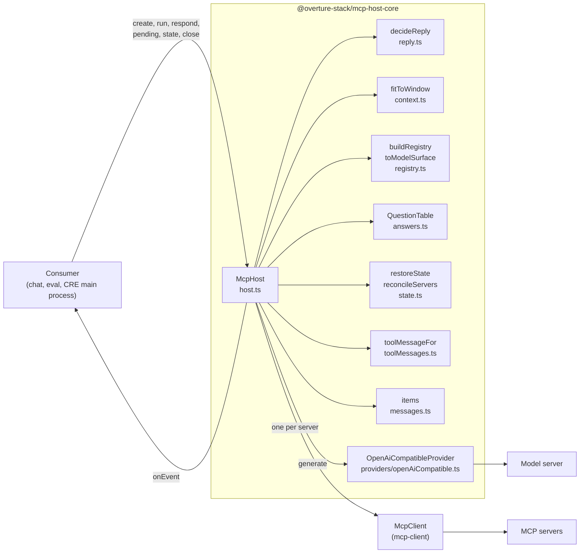
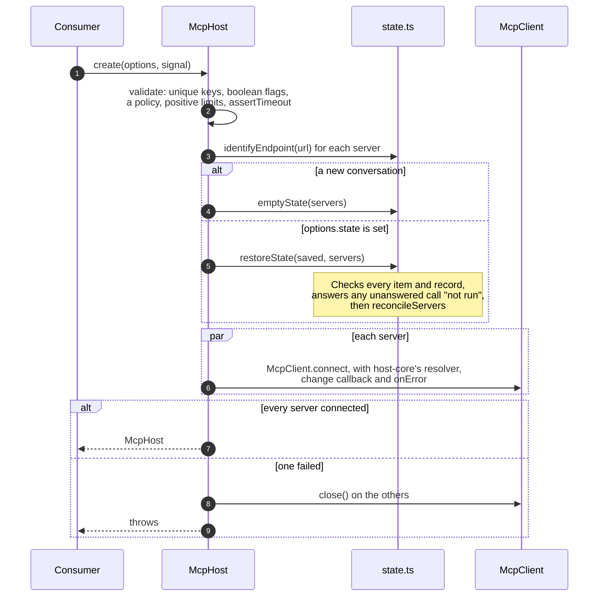
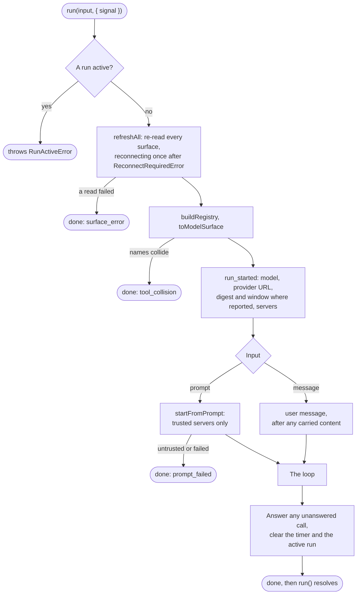
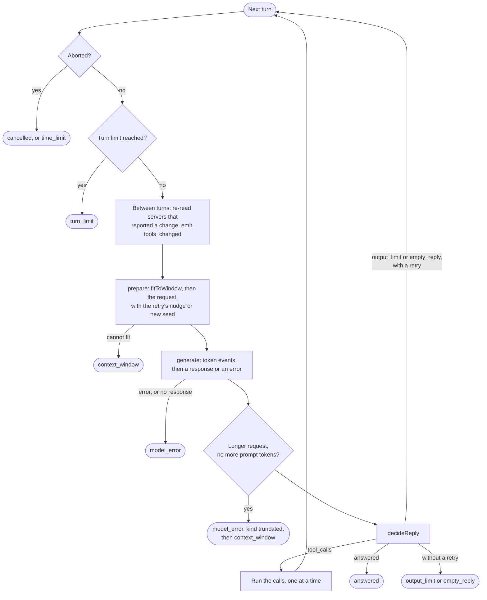
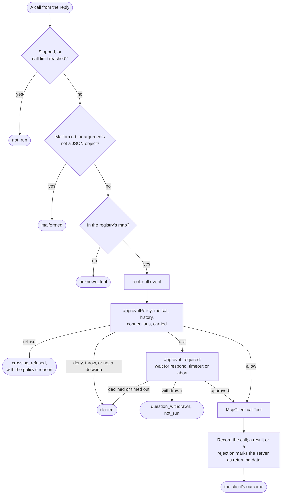
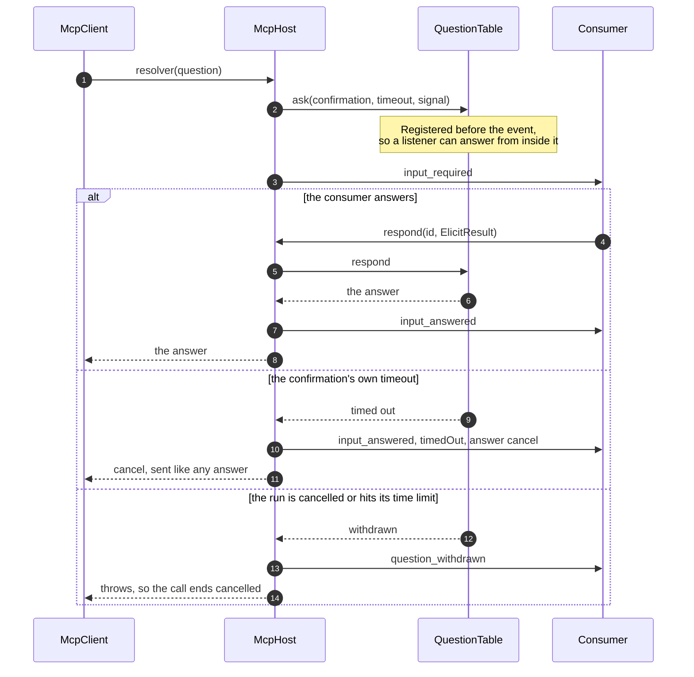
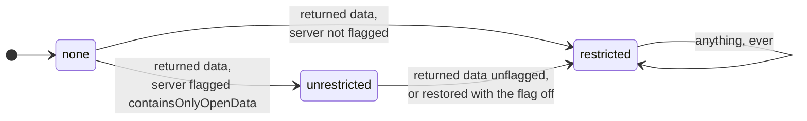

# mcp-host-core: Architecture

How `@overture-stack/mcp-host-core` works inside, drawn from its source. The [README](../README.md) covers usage, options and how a run ends. The [MCP Host Plan](../../../.dev/docs/mcp-host/mcp-host-plan.md) §2.2 records why each choice was made, and [Data Crossing Connections](../../../.dev/docs/mcp-host/data-crossing-options.md) the rule on data moving between servers. For where this module sits among the other pieces, see [MCP Host: Architecture](../../../.dev/docs/mcp-host/architecture.md).

Each section names the functions it draws and the test files that cover them.

## Module map

A consumer creates one `McpHost` per conversation. `McpHost` holds one `McpClient` per server and runs the agent loop, asking an `LlmProvider` for each turn and reporting everything through `onEvent`.

| File                            | Owns                                                                                                                                 |
| ------------------------------- | ------------------------------------------------------------------------------------------------------------------------------------ |
| `host.ts`                       | `McpHost`: options, connecting the clients, the run and its loop, tool calls, approvals, and bridging server questions to `respond`. |
| `reply.ts`                      | `decideReply`: what a run does with a model reply, including the one retry per model step.                                           |
| `context.ts`                    | The token estimate, shortening older tool results in the request, and the backstop for a server that truncated anyway.               |
| `registry.ts`                   | Reducing `mcp__<server>__<tool>` names, the collision check, the routing map, and the model-facing surface.                          |
| `answers.ts`                    | `QuestionTable`: open approvals and confirmations, their clocks, and `respond`'s four results.                                       |
| `state.ts`                      | The conversation's saved state: server records, what each returned, carried content, endpoint identity, and the checks on restore.   |
| `toolMessages.ts`               | The fixed tool-message wording, rendering a tool result as text, and the length cap.                                                 |
| `messages.ts`                   | The conversation items, shaped after the Responses API. Only this file and `state.ts` build or read their shapes.                    |
| `events.ts`                     | The event union. Every event is plain data.                                                                                          |
| `provider.ts`                   | The `LlmProvider` seam: requests, stream items, final responses and model errors.                                                    |
| `providers/openAiCompatible.ts` | The Chat Completions client on `eventsource-parser`, and Ollama's native window and digest reads.                                    |
| `timeouts.ts`                   | `assertTimeout`, since a Node timer above 2^31−1 ms fires at once.                                                                   |

**Not in this module:** presentation, persistence, reading configuration or the environment, Arranger knowledge, and enforcing the data-crossing rule. Host-core supplies the rule's inputs; how a conversation keeps servers apart waits on the plan's §5, question 4.

The loop never builds a conversation item or a tool message literally: it calls `messages.ts` and `toolMessages.ts`, so a change of shape or wording stays in one place.

## Creating a host

`McpHost.create` checks the options, builds or restores the state, and connects every server.

The resolver and the change callback are host-core's own, which is why host-core connects the clients rather than taking connected ones: `McpClient.connect` fixes both at connect.

**Tested in** `host.test.ts` (`create`, `data crossing inputs`) and `state.test.ts` (`restoreState`).

## A run

`run()` refuses to start while another run is active, then joins the consumer's signal with its own wall-clock timer.

`done` is emitted only after the run is over, so a listener can start the next run from it.

Carried content becomes the first user message, labelled as server text by `carriedLabel`, with a `content_carried` event and a record in `state.carried`. It is allowed only on an empty conversation.

**Tested in** `host.test.ts` (`a run`, `surfaces`, `prompts`, `carried content`).

## The loop

A turn is one `generate()` call. Each turn:

- **One retry per model step.** `decideReply` retries only a reply to a request that was not itself a retry, so a cut-off reply whose retry comes back empty ends the run.
- **A retry changes only the request.** The output-limit retry adds `OUTPUT_LIMIT_RETRY_MESSAGE` and lets the provider `reduceReasoning`; the empty-reply retry uses `seed + 1`. The failed attempt stays in the events, never the state.
- **A retry counts as a turn.**

**Tested in** `reply.test.ts` and `host.test.ts` (`model replies`, `cancellation and limits`).

## One tool call

Every call of a reply is recorded first, with host-core's own id (`call-<n>`), then run in order. Each path ends in exactly one tool message, written by `#answer` through `toolMessageFor`.

- **The text the model sees** is the tool's own content only for `result`, plus the server's message for `rejected`. Every other outcome has fixed wording, which is why only those two mark a server as having returned data.
- **The cap** cuts a tool message to `toolResultMaxChars` with the cut noted. The `tool_result` event keeps the whole outcome.
- **A call the time limit cut off** gets the transport-error wording, since whether it ran is unknown, not "the user cancelled".

**Tested in** `host.test.ts` (`tool messages`, `approvals and confirmations`) and `toolMessages.test.ts`.

## Questions and answers

`QuestionTable` holds every open approval and server confirmation. Host-core keeps the only clocks on them, so `respond`, `pending()` and the events always agree with what the server was sent.

`respond` returns `accepted`, `unknown` for an id never issued, `already_answered` (including a withdrawn question) or `timed_out`. It throws `TypeError` for an answer of the wrong shape, and the question stays open. An approval follows the same path, with `approval_required` and `approval_answered`.

**Tested in** `answers.test.ts` and `host.test.ts` (`approvals and confirmations`, `cancellation and limits`).

## The context window

Ollama truncates silently past its window, dropping the oldest messages, the person's question among them. So host-core estimates every request before sending it.

1. **Estimate:** the previous turn's counted prompt tokens, plus the change in characters since at `charsPerToken`, plus the reply cap. Reasoning counts only when the provider declares `sendsReasoning`. With no earlier count, every character counts.
2. **Window:** the smaller of the configured window and the one the provider reports (`contextWindow()`, from Ollama's `/api/ps`).
3. **Over the window:** under `shorten`, the oldest tool results are replaced in the request by `shortenedResult`'s stub, never the latest turn's, which `run.latestCalls` names. Under `fail`, the run ends. Either way, the state keeps every result whole.
4. **Backstop:** a longer request, shortened the same way, counted at no more prompt tokens than the last means the server truncated it, and the run ends.

**Tested in** `context.test.ts` and `host.test.ts` (`context window`, `reported context window`).

## State and the data-crossing inputs

The state is plain data a consumer saves and hands back. Beside the items it records what the rule on data crossing connections needs.

- **`servers`:** every server the conversation has held, kept after a restore drops it, each with `returnedData` above. It only ever rises, so no change to a flag loosens what is already in the conversation.
- **Endpoint identity:** `identifyEndpoint` keeps the readable origin and a SHA-256 of the URL without user info or fragment. Path and query both count, and neither is saved, so a key carried in the URL never reaches the state. A key rotated in the URL therefore counts as another server.
- **`carried`:** what the person carried in. It marks no server, but it closes the server set, since the person picked its destinations.
- **On restore,** `reconcileServers` refuses any server added, including a key whose endpoint changed, when the conversation holds restricted data or carried content.
- **For a policy:** `holdsRestrictedData` says whether any restricted data is present; `carriesRestrictedData` says whether a call would carry another server's restricted data out, the test under way (a).
- **`state()`** returns a copy with every unanswered call answered (`withEveryCallAnswered`): "abandoned" for one waiting on a confirmation, which is never resumed, and the transport-error wording for one on the wire.

**Tested in** `state.test.ts` and `host.test.ts` (`conversation state`, `data crossing inputs`).

## The OpenAI-compatible provider

`OpenAiCompatibleProvider.generate` sends one request and yields deltas, then exactly one `response` or `error`. It never throws, never retries and reads no environment variables.

- **The request:** `toWireMessages` groups a turn's calls on one assistant message and keys each tool result by the model's own call id. A malformed call's text is sent back wrapped as `{"unparsed": ...}`, since a server may refuse arguments that are not an object. `extra` is spread last.
- **The key:** a string, or a function called before every request. A 401 is a `model_error` with its status.
- **The stream:** `eventsource-parser` frames events, with an 8 MiB cap on one event. `foldChunk` gathers text, reasoning and tool-call fragments by index, then sorts them, so indexes may start anywhere and arrive in any order. A whole reply folds through the same function as one chunk.
- **Errors:** an HTTP status with a bounded body; `aborted`, `timeout` and `network`, told apart by which signal ended the request; an error event or unreadable data in the stream; a refusal; and a stream with no `finish_reason`, which Ollama's `/v1` sends when it drops an error mid-stream.
- **Ollama:** with `ollama`, `contextWindow()` reads `/api/ps` and `modelDigest()` reads `/api/tags`. Every model call still goes through `/v1`.

**Tested in** `providers/openAiCompatible.test.ts`, against `testing/modelServer.ts`, which splits its stream wherever a test asks, and `host.test.ts` (`with the OpenAI-compatible provider`), end to end.

## Test support

| File                          | What it is                                                                                                            |
| ----------------------------- | --------------------------------------------------------------------------------------------------------------------- |
| `testing/server.ts`           | An in-process MCP server over loopback HTTP, with a tool for each name shape, content kind and outcome, and a prompt. |
| `testing/scriptedProvider.ts` | A provider that replays scripted replies, hangs, errors or throws, and records every request.                         |
| `testing/modelServer.ts`      | A loopback Chat Completions server whose stream a test writes byte by byte.                                           |

None of these is built or exported. The test server is host-core's own rather than `mcp-client`'s, so it moves with host-core in Phase 5.
