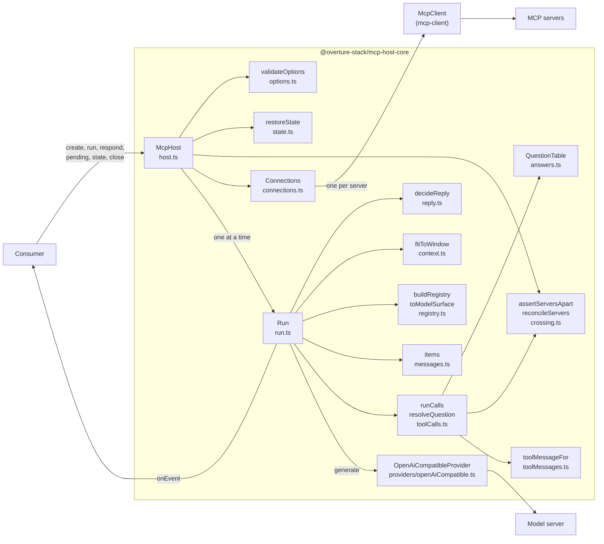
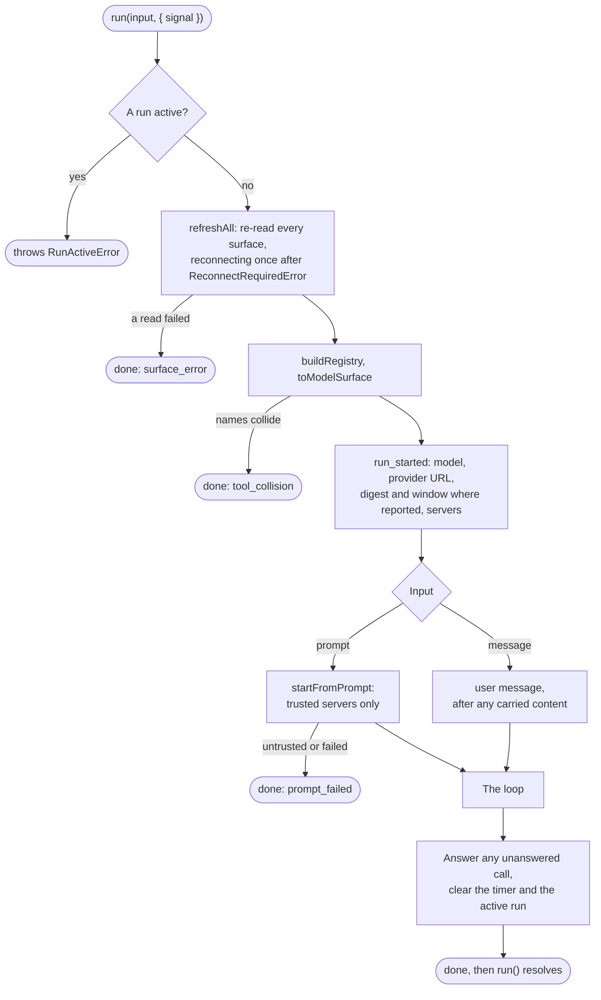
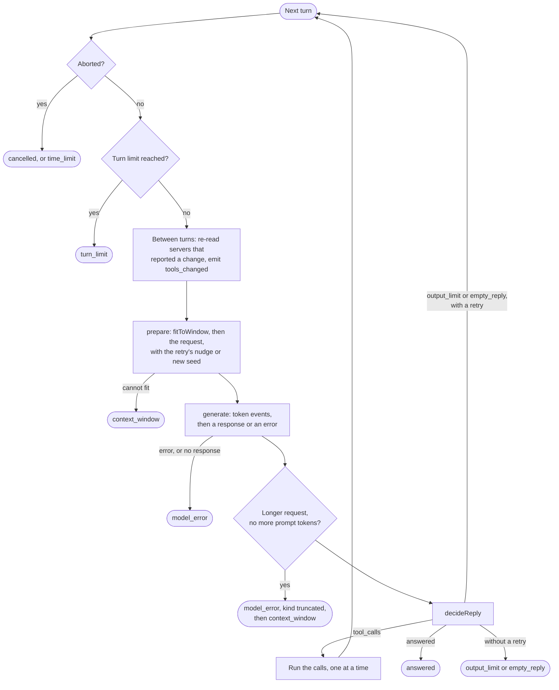
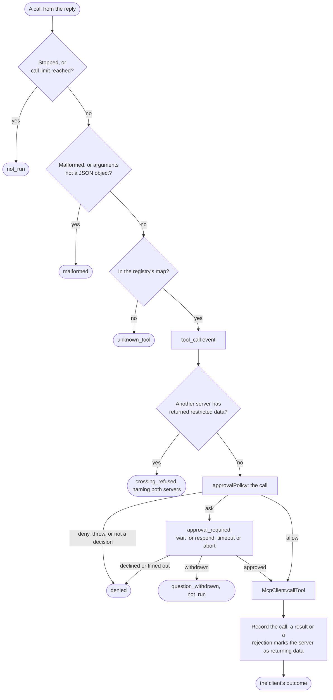
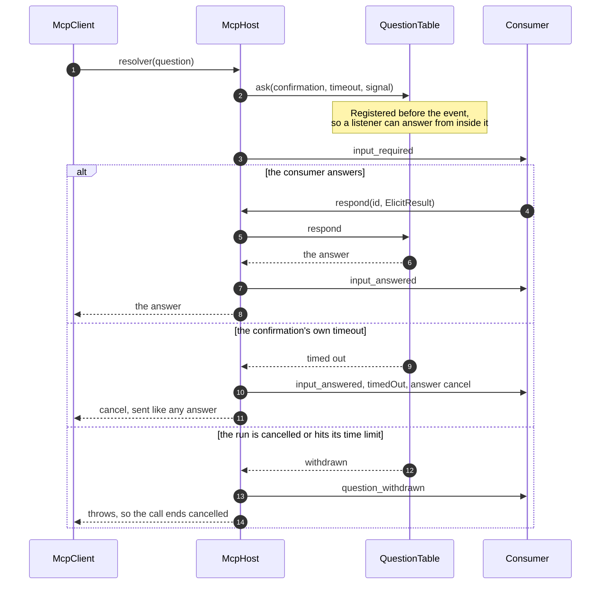
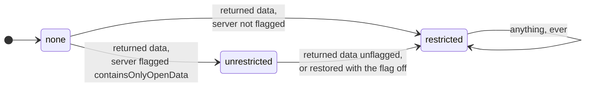

# mcp-host-core: Architecture

How `@overture-stack/mcp-host-core` works inside, drawn from its source. The [README](../README.md) covers usage, options and how a run ends. The rule on data moving between servers is under [State and data crossing](#state-and-data-crossing), and the source comments give the reasons behind its choices.

Each section names the functions it draws and the test files that cover them.

## Module map

A consumer creates one `McpHost` per conversation. `McpHost` holds one `McpClient` per server through `Connections`, and starts one `Run` at a time. The run drives the agent loop, asking an `LlmProvider` for each turn, hands each tool call to `toolCalls.ts`, and reports everything through `onEvent`.



| File                            | Owns                                                                                                                                                                           |
| ------------------------------- | ------------------------------------------------------------------------------------------------------------------------------------------------------------------------------ |
| `host.ts`                       | `McpHost`: creating a conversation, `respond`, `pending`, `state`, `surface`, `close`, and `run`, which starts one `Run` at a time and emits its `done` once it has let it go. |
| `options.ts`                    | The options a consumer configures, and `validateOptions`, which checks what types cannot.                                                                                      |
| `connections.ts`                | `Connections`: one `McpClient` per server, connected with host-core's resolver and change callback, and re-reading their surfaces.                                             |
| `run.ts`                        | `Run`: the agent loop, from the input through each model turn to how the run ended, and every event it emits.                                                                  |
| `toolCalls.ts`                  | Each tool call: routing, the data-crossing guard, approval, the call and its tool message; and bridging server questions to `respond`.                                         |
| `reply.ts`                      | `decideReply`: what a run does with a model reply, including the one retry per model step.                                                                                     |
| `context.ts`                    | The token estimate, shortening older tool results in the request, and the backstop for a server that truncated anyway.                                                         |
| `registry.ts`                   | Reducing `mcp__<server>__<tool>` names, the collision check, the routing map, and the model-facing surface.                                                                    |
| `answers.ts`                    | `QuestionTable`: open approvals and confirmations, their clocks, and `respond`'s four results.                                                                                 |
| `state.ts`                      | The conversation's saved state: its items, calls, server records and carried content, and restoring it.                                                                        |
| `crossing.ts`                   | The data-crossing rule: what each server returned, endpoint identity, and the checks that keep servers apart.                                                                  |
| `toolMessages.ts`               | The fixed tool-message wording, rendering a tool result as text, and the length cap.                                                                                           |
| `messages.ts`                   | The conversation items, shaped after the Responses API. The rest of the module builds and reads them through this file, apart from each provider.                              |
| `events.ts`                     | The event union. Every event is plain data.                                                                                                                                    |
| `provider.ts`                   | The `LlmProvider` seam: requests, stream items, final responses and model errors.                                                                                              |
| `providers/openAiCompatible.ts` | The Chat Completions client on `eventsource-parser`, and Ollama's native window and digest reads.                                                                              |
| `constants.ts`                  | Every set of values the module defines, such as event types and done reasons, as `as const` objects the union types derive from.                                               |
| `utils.ts`                      | General helpers: `isRecord`, `parseJson`, `errorMessage`, `untilAborted`, and `assertTimeout`, since a Node timer above 2^31−1 ms fires at once.                               |

**Not in this module:** presentation, persistence, reading configuration or the environment, and Arranger knowledge. The data-crossing rule is in it, so every consumer gets it: see [State and data crossing](#state-and-data-crossing).

The loop never builds a conversation item or a tool message literally: it calls `messages.ts` and `toolMessages.ts`, so a change of shape or wording stays in one place.

## Creating a host

`McpHost.create` checks the options, builds or restores the state, and connects every server.

```mermaid
sequenceDiagram
    autonumber
    participant C as Consumer
    participant H as McpHost
    participant S as state.ts
    participant X as crossing.ts
    participant M as McpClient

    C->>H: create(options, signal)
    H->>H: validateOptions: unique keys, boolean flags,<br/>a policy, positive limits, assertTimeout
    H->>X: identifyEndpoint(url) for each server
    alt a new conversation
        H->>S: emptyState(servers)
    else options.state is set
        H->>S: restoreState(saved, servers)
        Note over S: Checks every item and record,<br/>answers any unanswered call "not run",<br/>then reconcileServers
    end
    H->>X: assertServersApart(servers, state.servers)
    Note over X: An unflagged server beside any other,<br/>or any server beside restricted data<br/>from another, throws ServerSetError;<br/>nothing connects
    par each server
        H->>M: McpClient.connect, with host-core's resolver,<br/>change callback and onError
    end
    alt every server connected
        H-->>C: McpHost
    else one failed
        H->>M: close() on the others
        H-->>C: throws
    end
```

The resolver and the change callback are host-core's own, which is why host-core connects the clients rather than taking connected ones: `McpClient.connect` fixes both at connect.

**Tested in** `host.test.ts` (`create`), `crossing.test.ts` (`assertServersApart`, `data crossing`) and `state.test.ts` (`restoreState`).

## A run

`run()` refuses to start while another run is active, then joins the consumer's signal with its own wall-clock timer.



`done` is emitted only after the run is over, so a listener can start the next run from it.

Carried content becomes the first user message, labelled as server text by `carriedLabel`, with a `content_carried` event and a record in `state.carried`. It is allowed only on an empty conversation.

**Tested in** `host.test.ts` (`a run`, `surfaces`, `prompts`, `carried content`).

## The loop

A turn is one `generate()` call. Each turn:



- **One retry per model step.** `decideReply` retries only a reply to a request that was not itself a retry, so a cut-off reply whose retry comes back empty ends the run.
- **A retry changes only the request.** The output-limit retry adds `OUTPUT_LIMIT_RETRY_MESSAGE` and lets the provider `reduceReasoning`; the empty-reply retry uses `seed + 1`. The failed attempt stays in the events, never the state.
- **A retry counts as a turn.**

**Tested in** `reply.test.ts` and `run.test.ts` (`model replies`, `cancellation and limits`).

## One tool call

Every call of a reply is recorded first, with host-core's own id (`call-<n>`), then run in order. Each path ends in exactly one tool message, written by `toolCalls.ts`'s `answer` through `toolMessageFor`.



- **The text the model sees** is the tool's own content only for `result`, plus the server's message for `rejected`. Every other outcome has fixed wording, which is why only those two mark a server as having returned data.
- **The cap** cuts a tool message to `toolResultMaxChars` with the cut noted. The `tool_result` event keeps the whole outcome.
- **A call the time limit cut off** gets the transport-error wording, since whether it ran is unknown, not "the user cancelled".

**Tested in** `toolCalls.test.ts` (`tool messages`, `approvals and confirmations`) and `toolMessages.test.ts`.

## Questions and answers

`QuestionTable` holds every open approval and server confirmation. Host-core keeps the only clocks on them, so `respond`, `pending()` and the events always agree with what the server was sent.



`respond` returns `accepted`, `unknown` for an id never issued, `already_answered` (including a withdrawn question) or `timed_out`. It throws `TypeError` for an answer of the wrong shape, and the question stays open. An approval follows the same path, with `approval_required` and `approval_answered`.

**Tested in** `answers.test.ts`, `toolCalls.test.ts` (`approvals and confirmations`) and `run.test.ts` (`cancellation and limits`).

## The context window

Ollama truncates silently past its window, dropping the oldest messages, the person's question among them. So host-core estimates every request before sending it.

1. **Estimate:** the previous turn's counted prompt tokens, plus the change in characters since at `charsPerToken`, plus the reply cap. Reasoning counts only when the provider declares `sendsReasoning`. With no earlier count, every character counts.
2. **Window:** the smaller of the configured window and the one the provider reports (`contextWindow()`, from Ollama's `/api/ps`).
3. **Over the window:** under `shorten`, the oldest tool results are replaced in the request by `shortenedResult`'s stub, never the latest turn's, which `run.latestCalls` names. Under `fail`, the run ends. Either way, the state keeps every result whole.
4. **Backstop:** a longer request, shortened the same way, counted at no more prompt tokens than the last means the server truncated it, and the run ends.

**Tested in** `context.test.ts`, `run.test.ts` (`context window`) and `host.test.ts` (`reported context window`).

## State and data crossing

The state is plain data a consumer saves and hands back. Beside the items it records what the rule on data crossing connections needs, and host-core enforces the rule from it.



- **`servers`:** every server the conversation has held, kept after a restore drops it, each with `returnedData` above. It only ever rises, so no change to a flag loosens what is already in the conversation.
- **Endpoint identity:** `identifyEndpoint` keeps the readable origin and a SHA-256 of the URL without user info or fragment. Path and query both count, and neither is saved, so a key carried in the URL never reaches the state. A key rotated in the URL therefore counts as another server.
- **`carried`:** what the person carried in. It marks no server, but it closes the server set, since the person picked its destinations.
- **When a conversation starts,** `assertServersApart` refuses a server not flagged `containsOnlyOpenData` beside any other, and, on a restore, any server beside another whose data is restricted, as one whose flag was turned off and on again is. Nothing has connected yet.
- **On restore,** `reconcileServers` refuses any server added, including a key whose endpoint changed, when the conversation holds restricted data or carried content.
- **Before each call,** `restrictedDataFrom` names any other server that has returned restricted data, and the call ends as `crossing_refused` before the policy is asked. No such call remains, so it guards against a fault in the checks before it.
- **For a consumer:** `holdsRestrictedData` says whether any restricted data is present, for its own rules, such as saving.
- **`state()`** returns a copy with every unanswered call answered (`withEveryCallAnswered`): "abandoned" for one waiting on a confirmation, which is never resumed, and the transport-error wording for one on the wire.

**Tested in** `state.test.ts`, `crossing.test.ts` (including `data crossing`) and `host.test.ts` (`conversation state`).

## The OpenAI-compatible provider

`OpenAiCompatibleProvider.generate` sends one request and yields deltas, then exactly one `response` or `error`. It never throws, never retries and reads no environment variables.

- **The request:** `toWireMessages` groups a turn's calls on one assistant message and keys each tool result by the model's own call id. A malformed call's text is sent back wrapped as `{"unparsed": ...}`, since a server may refuse arguments that are not an object. `extra` is spread last.
- **The key:** a string, or a function called before every request. A 401 is a `model_error` with its status.
- **The stream:** `eventsource-parser` frames events, with an 8 MiB cap on one event. `foldChunk` gathers text, reasoning and tool-call fragments by index, then sorts them, so indexes may start anywhere and arrive in any order. A whole reply folds through the same function as one chunk.
- **Errors:** an HTTP status with a bounded body; `aborted`, `timeout` and `network`, told apart by which signal ended the request; an error event or unreadable data in the stream; a refusal; and a stream with no `finish_reason`, which Ollama's `/v1` sends when it drops an error mid-stream.
- **Ollama:** with `ollama`, `contextWindow()` reads `/api/ps` and `modelDigest()` reads `/api/tags`. Every model call still goes through `/v1`.

**Tested in** `providers/openAiCompatible.test.ts`, against `testing/modelServer.ts`, which splits its stream wherever a test asks, and `host.test.ts` (`with the OpenAI-compatible provider`), end to end.

## Test support

| File                          | What it is                                                                                                                             |
| ----------------------------- | -------------------------------------------------------------------------------------------------------------------------------------- |
| `testing/server.ts`           | An in-process MCP server over loopback HTTP, with a tool for each name shape, content kind and outcome, and a prompt.                  |
| `testing/scriptedProvider.ts` | A provider that replays scripted replies, hangs, errors or throws, and records every request.                                          |
| `testing/modelServer.ts`      | A loopback Chat Completions server whose stream a test writes byte by byte.                                                            |
| `testing/harness.ts`          | The host tests' harness: a scripted provider, options for one test server, the events a run emits, and helpers to run a host and wait. |

None of these is built or exported. The test server is host-core's own rather than `mcp-client`'s, so it moves with host-core to its own repository.
